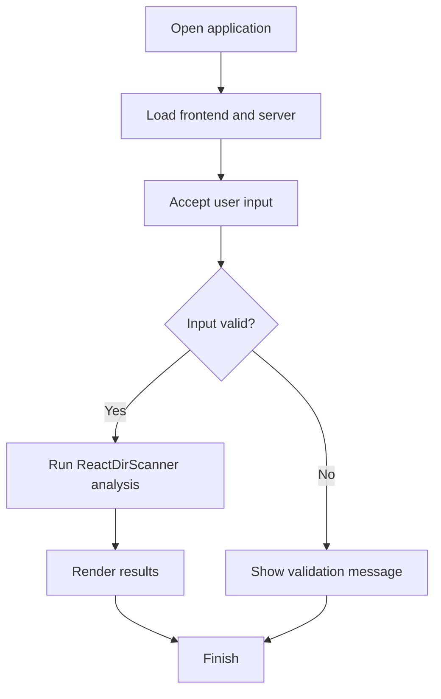

# ⚡ ReactDirScanner


## Get this repository

Clone the current project (this repository's canonical GitHub URL), then follow the installation and usage steps below.

```bash
git clone https://github.com/cyberworlduniversity/ReactDirScanner.git
cd ReactDirScanner
```
### Hidden Directory & File Finder | Inspired by DirBuster

> ⚠️ **Legal Disclaimer:** Use this tool ONLY on websites you own or have explicit written permission to test. Unauthorized scanning is illegal.

---

## 📁 Project Files (Flat Structure)

```
ReactDirScanner/
├── server.js       ← Express backend (scan engine)
├── package.json    ← Dependencies
├── App.jsx         ← React frontend dashboard
└── README.md       ← This file
```

---

## 🚀 Quick Setup

### 1. Install Dependencies
```bash
npm install
```

### 2. Start Backend Server
```bash
npm start
# Server runs on http://localhost:3001
```

### 3. Setup React Frontend
Create a new React app and replace App.jsx:
```bash
npx create-react-app client
cp App.jsx client/src/App.jsx
cd client && npm start
# Frontend runs on http://localhost:3000
```

---

## 🔧 Features

| Feature | Description |
|--------|-------------|
| 🔍 Directory Brute-Force | Tests 50+ common hidden paths |
| 📊 Status Code Detection | Color-coded: 200 / 301 / 403 / 500 |
| 📏 Response Size Analysis | Shows response size in bytes |
| ⚡ Real-Time Progress | Live scan progress bar |
| 🛑 Stop Scan | Cancel scan mid-way |
| 📥 Export CSV | Download results as CSV |
| 🔧 Custom Wordlist | Paste your own paths |
| ⚙️ Concurrency Control | Adjust parallel requests |

---

## 🌐 API Endpoints

| Method | Endpoint | Description |
|--------|----------|-------------|
| POST | `/api/scan/start` | Start a new scan |
| GET | `/api/scan/status/:id` | Get scan progress & results |
| POST | `/api/scan/stop/:id` | Stop a running scan |
| GET | `/api/wordlist` | Get default wordlist |

### Start Scan Request Body
```json
{
  "target": "https://example.com",
  "customWordlist": ["admin", "login"],
  "timeout": 5000,
  "concurrency": 10
}
```

---

## 📦 Dependencies

```json
{
  "express": "^4.18.2",
  "axios": "^1.6.0",
  "cors": "^2.8.5"
}
```

---

## 👤 Author
**hemanathan115**

---

*ReactDirScanner v1.0 — For authorized penetration testing only*


## Repository Quick Start

Clone the canonical repository:

```bash
git clone https://github.com/cyberworlduniversity/ReactDirScanner.git
cd ReactDirScanner
```

### Requirements and installation

- Node.js 18+

```bash
npm install
```

### Start the application

```bash
npm start
```

The API server starts on the port configured in server.js. App.jsx is supplied as a React component; the repository does not include a client/ scaffold, so create/configure a separate React client before using the dashboard.

### Build / validation

Check that dependencies install cleanly and that the application starts without runtime errors. No automated test script is currently declared in package.json.

Directory discovery must be limited to systems and paths you are authorized to test.

### Application flow


